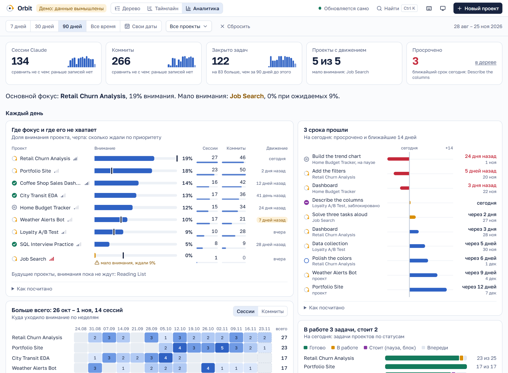
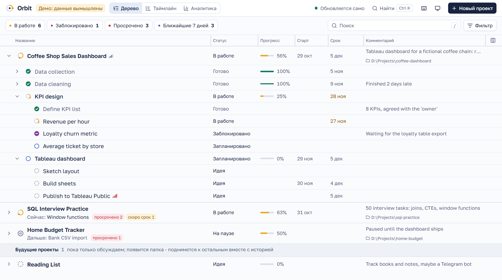
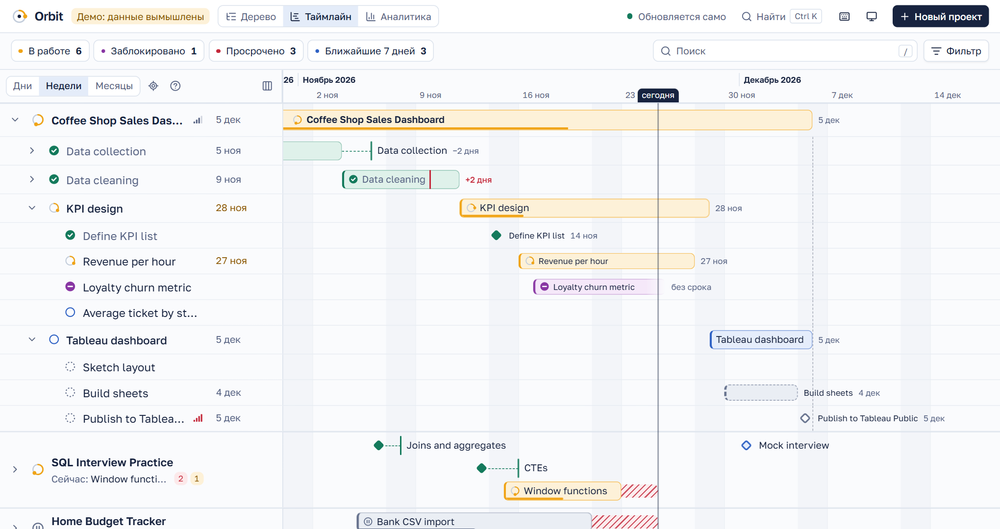
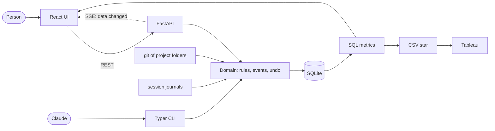

# Orbit

[](https://github.com/VladimirB23/orbit/actions/workflows/check.yml)

<!-- The link to the Tableau Public dashboard goes here. -->

**One place to control every project: the ones in work and the ones that are only ideas, down to single sessions with
Claude.** Orbit shows what comes first, what is being neglected and what can be dropped and forgotten. Claude reads and
changes the data through a CLI, the screen follows within two seconds, every edit can be undone. [Русская версия](README.ru.md)

<picture>
  <source media="(prefers-color-scheme: dark)" srcset="docs/images/analytics-dark.png">
  
</picture>

*All data in the pictures is fictional. The interface is in Russian, the code and the CLI are in English.*

## What it is for

I run several projects at once and keep a queue of ideas, and most of the work happens in sessions with Claude. Those
sessions, promises and half-started ideas used to be scattered over folders and chats. Orbit keeps all of it in view:

- **Everything in one tree:** projects, milestones and tasks; ideas without a folder stay apart until they become projects.
- **Sessions under control:** each Claude session is tied to the project it was about, with its volume and a command to
  continue it.
- **First things first:** the share of sessions and commits each project gets against the share its priority asks for.
- **What to drop:** how long a project has stood still, what is overdue, what never left the idea stage.

On the demo history above, the project with the highest priority got 1 of 134 sessions in 90 days. The data is
generated and this effect was put there on purpose; the screen is what finds it.

## What is worth a look

| | Where |
| --- | --- |
| **Metrics are plain SQL**, one commented file per step: window functions, a recursive calendar, a median without `MEDIAN`, plan against fact from the event log | [`domain/sql`](backend/src/orbit/domain/sql), [definitions](docs/metrics.md) (Russian) |
| **Honest empty states.** With too little data a chart says what is missing; there is no comparison with a period nobody recorded | [`test_analytics.py`](backend/tests/test_analytics.py) |
| **Star schema export** for Tableau: 4 dimensions, 4 facts, a data dictionary; an export of real data is labelled private | [`export.py`](backend/src/orbit/export.py) |
| **An agent as a user.** `--json` on every command, exit codes by kind of error, every change signed by its author | [`cli`](backend/src/orbit/cli) |
| **Undo from the journal**, not from browser memory: it survives a reload, brings back a deleted milestone with everything inside and refuses to overwrite newer edits | [`undo.py`](backend/src/orbit/domain/undo.py) |
| **Safe without logins:** listens only on `127.0.0.1`; checks against DNS rebinding and cross-site requests, a CSP without foreign scripts | [`security.py`](backend/src/orbit/api/security.py) |
| **Decisions are written down** with the options that lost | [`docs/adr`](docs/adr) (Russian) |

<details>
<summary>Tree and timeline</summary>

<picture>
  <source media="(prefers-color-scheme: dark)" srcset="docs/images/tree-dark.png">
  
</picture>

<picture>
  <source media="(prefers-color-scheme: dark)" srcset="docs/images/timeline-dark.png">
  
</picture>

</details>

## Run it

Windows, [Git](https://git-scm.com), [uv](https://docs.astral.sh/uv/) and [Node.js](https://nodejs.org) 22.12 or newer.
uv brings Python itself. In Command Prompt, about three minutes with empty caches:

```bat
git clone https://github.com/VladimirB23/orbit.git
cd orbit\frontend
npm ci
npm run build
cd ..
bin\orbit seed --demo --half-year
bin\orbit --db data\demo-half-year.db serve
```

The browser opens `http://127.0.0.1:8420`; press `A` for analytics. `Ctrl+C` stops the server. Now change something from
a second terminal in the same folder and watch the page:

```bat
bin\orbit --db data\demo-half-year.db task list --open
bin\orbit --db data\demo-half-year.db set project job-search --status paused
bin\orbit --db data\demo-half-year.db undo
```

<details>
<summary>Your own data, shortcuts, export</summary>

```bat
bin\orbit project add my-project --name "My project" --repo C:\code\my-project
bin\orbit serve
bin\orbit --db data\demo-half-year.db export --csv out\tableau
```

Your data lives in `data\orbit.db` and stays out of git. A desktop icon, a window of its own and a server without a
console ([ADR 0009](docs/adr/0009-desktop-launch.md)); `-WhatIf` shows, `-Remove` takes away:

```bat
powershell -ExecutionPolicy Bypass -File bin\shortcuts.ps1 -WhatIf
powershell -ExecutionPolicy Bypass -File bin\shortcuts.ps1
```

An optional `data\orbit.toml`: `vault = 'path\to\Obsidian vault'` turns on links to notes and the import of session
journals, `auto_dates = true` gives planned things a deadline.

</details>

## How it is built



One domain layer serves both the API and the CLI, so a rule exists once. TypeScript types are generated from the API
schema, and a test fails when they are out of date.

Python 3.13, FastAPI, SQLAlchemy 2, Alembic, SQLite · React 19, TypeScript, TanStack, Tailwind, shadcn/ui · uv, ruff,
mypy strict, pytest, Vitest, Playwright, axe.

`sh bin/check` in Git Bash (or `bin\check`) runs what CI runs: lint, types, 563 backend tests, 219 frontend tests and 133
scenarios in Edge, accessibility in both themes included.

## Limits

- One person, one computer. No accounts, no cloud, no phone.
- Developed and tested on Windows only. The server may work elsewhere, the shortcuts will not.
- Sessions come from journals kept by a Claude Code hook that is not part of this repository; the format is in
  [`journal.py`](backend/src/orbit/journal.py). Without journals, commits still count.
- Attention is measured by the number of sessions and commits, not by hours: a session may stay open for days.
- Next: a Tableau Public dashboard on the same demo data, an MCP server, a day planner.

## Who did what

The product, the requirements and the choices between options are mine; most of the code was written by Claude Code under
my direction, stage by stage, which is why the commits carry a co-author line. Tracking that kind of work is what Orbit
is for, and it tracked its own development.

[MIT](LICENSE). Components in `frontend/src/components/ui` are adapted from [shadcn/ui](https://ui.shadcn.com) (MIT).
