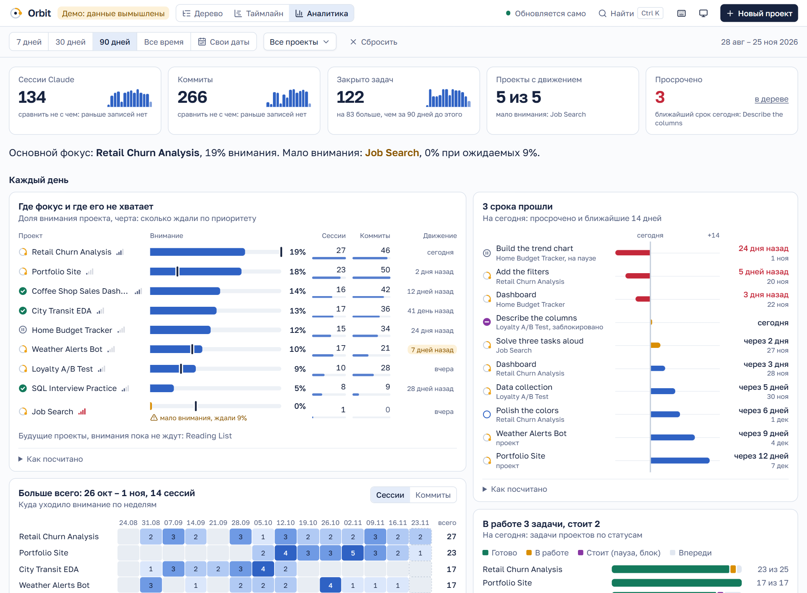
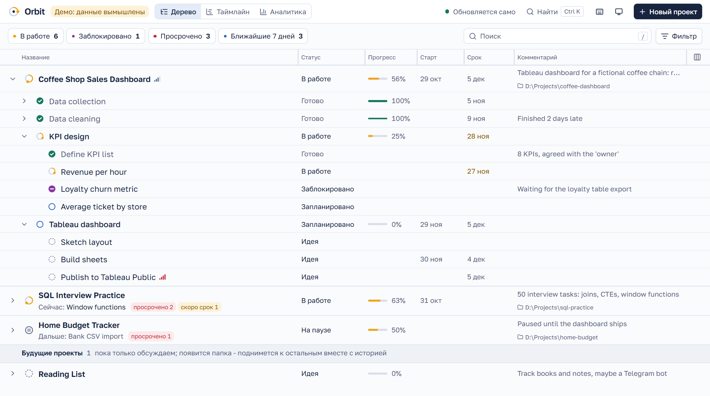
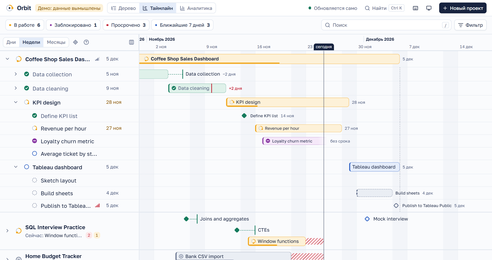
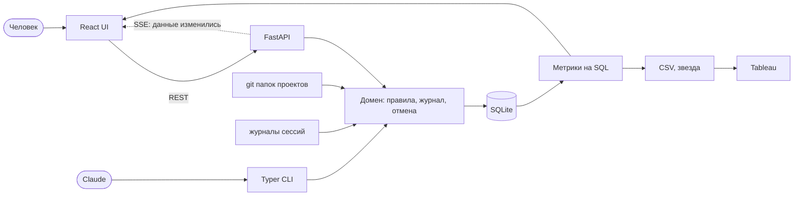

# Orbit

[](https://github.com/VladimirB23/orbit/actions/workflows/check.yml)

<!-- The link to the Tableau Public dashboard goes here. -->

**Локальный трекер проектов для человека и ИИ-агента с аналитикой: куда на самом деле уходит внимание.**
Claude читает и меняет данные через CLI, браузер показывает изменение за две секунды, любую правку можно отменить по
журналу. [English version](README.md)

<picture>
  <source media="(prefers-color-scheme: dark)" srcset="docs/images/analytics-dark.png">
  
</picture>

*Все данные на снимках вымышленные.*

## На какой вопрос отвечает

Я веду несколько проектов сразу, и большая часть работы идет в сессиях с ИИ-агентом. Список сроков не скажет, какой
проект получает мое время, а какой важен только на словах. Orbit сравнивает: долю сессий и коммитов с долей, которую
просят приоритеты.

В демо-истории на снимке проект с высшим приоритетом получил 1 сессию из 134 за 90 дней. История сгенерирована, и этот
эффект заложен намеренно; задача экрана - его найти.

## Что посмотреть

| | Где |
| --- | --- |
| **Метрики на чистом SQL**, один файл с комментарием на шаг: оконные функции, рекурсивный календарь, медиана без `MEDIAN`, план и факт по журналу событий | [`domain/sql`](backend/src/orbit/domain/sql), [определения](docs/metrics.md) |
| **Честные пустые состояния.** Мало данных - график говорит, чего не хватает; с периодом без записей ничего не сравнивается | [`test_analytics.py`](backend/tests/test_analytics.py) |
| **Выгрузка звездой** для Tableau: 4 измерения, 4 таблицы фактов, словарь полей; выгрузка настоящих данных помечается как личная | [`export.py`](backend/src/orbit/export.py) |
| **Агент как пользователь.** `--json` у каждой команды, коды ошибок по видам, у каждого изменения есть автор | [`cli`](backend/src/orbit/cli) |
| **Отмена по журналу**, а не из памяти браузера: переживает перезагрузку, возвращает удаленный этап со всем содержимым, не затирает более новые правки | [`undo.py`](backend/src/orbit/domain/undo.py) |
| **Безопасность без логинов:** только `127.0.0.1`, защита от DNS rebinding и межсайтовых запросов, CSP без чужих скриптов | [`security.py`](backend/src/orbit/api/security.py) |
| **Решения записаны** вместе с отвергнутыми вариантами | [`docs/adr`](docs/adr) |

<details>
<summary>Дерево и таймлайн</summary>

<picture>
  <source media="(prefers-color-scheme: dark)" srcset="docs/images/tree-dark.png">
  
</picture>

<picture>
  <source media="(prefers-color-scheme: dark)" srcset="docs/images/timeline-dark.png">
  
</picture>

</details>

## Запуск

Windows, [Git](https://git-scm.com), [uv](https://docs.astral.sh/uv/) и [Node.js](https://nodejs.org) 22.12 или новее.
Python uv поставит сам. В Command Prompt, около трех минут с пустыми кэшами:

```bat
git clone https://github.com/VladimirB23/orbit.git
cd orbit\frontend
npm ci
npm run build
cd ..
bin\orbit seed --demo --half-year
bin\orbit --db data\demo-half-year.db serve
```

Браузер откроет `http://127.0.0.1:8420`; `A` - аналитика. `Ctrl+C` останавливает сервер. Теперь измени что-нибудь из
второго терминала в той же папке и посмотри на страницу:

```bat
bin\orbit --db data\demo-half-year.db task list --open
bin\orbit --db data\demo-half-year.db set project job-search --status paused
bin\orbit --db data\demo-half-year.db undo
```

<details>
<summary>Свои данные, ярлыки, выгрузка</summary>

```bat
bin\orbit project add my-project --name "My project" --repo C:\code\my-project
bin\orbit serve
bin\orbit --db data\demo-half-year.db export --csv out\tableau
```

Данные лежат в `data\orbit.db` и в git не попадают. Иконка на рабочем столе, отдельное окно и сервер без консоли
([ADR 0009](docs/adr/0009-desktop-launch.md)); `-WhatIf` покажет, `-Remove` уберет:

```bat
powershell -ExecutionPolicy Bypass -File bin\shortcuts.ps1 -WhatIf
powershell -ExecutionPolicy Bypass -File bin\shortcuts.ps1
```

Необязательный файл `data\orbit.toml`: `vault = 'path\to\Obsidian vault'` включает ссылки на заметки и импорт журналов
сессий, `auto_dates = true` ставит срок запланированному.

</details>

## Как устроено



У API и CLI один доменный слой, поэтому каждое правило живет в одном месте. Типы TypeScript генерируются из схемы API:
устарели - падает тест.

Python 3.13, FastAPI, SQLAlchemy 2, Alembic, SQLite · React 19, TypeScript, TanStack, Tailwind, shadcn/ui · uv, ruff,
mypy strict, pytest, Vitest, Playwright, axe.

`sh bin/check` в Git Bash (или `bin\check`) запускает то же, что CI: линт, типы, 556 теста бэкенда, 207 тестов фронта и
131 сценарий в Edge, включая доступность в обеих темах.

## Ограничения

- Один человек, один компьютер. Нет учетных записей, облака и телефона.
- Разработан и проверен только на Windows. Сервер может заработать и на других системах, ярлыки - нет.
- Сессии берутся из журналов, которые ведет хук Claude Code; сам хук в репозиторий не входит, формат описан в
  [`journal.py`](backend/src/orbit/journal.py). Без журналов считаются коммиты.
- Внимание измеряется числом сессий и коммитов, а не часами: сессия может висеть открытой сутками.
- Дальше: дашборд в Tableau Public на тех же демо-данных, MCP-сервер, планер на день.

## Кто что делал

Идея, требования и выбор вариантов мои; большую часть кода написал Claude Code под моим управлением, этап за этапом,
поэтому в коммитах указан соавтор. Orbit нужен как раз для такой работы, и собственную разработку он вел сам.

[MIT](LICENSE). Компоненты в `frontend/src/components/ui` взяты из [shadcn/ui](https://ui.shadcn.com) (MIT) и изменены.
